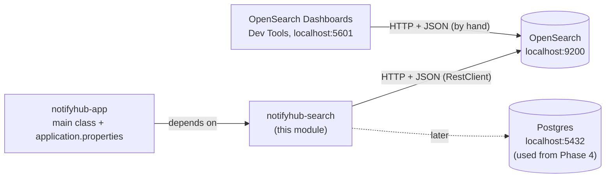
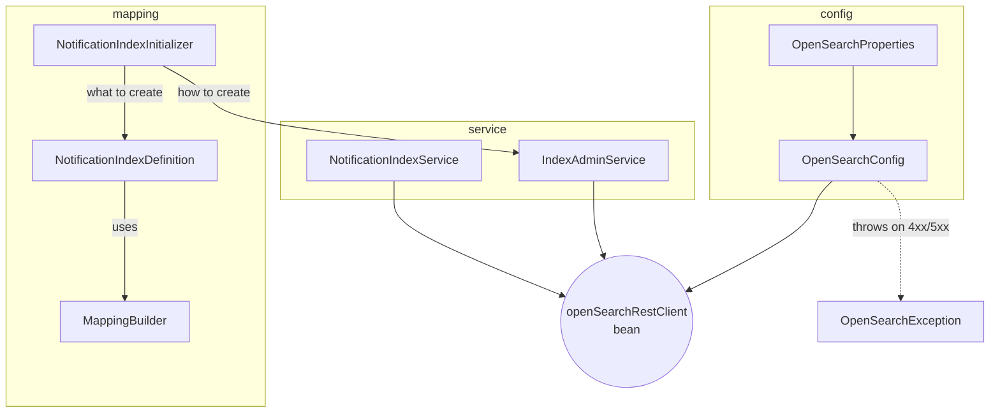
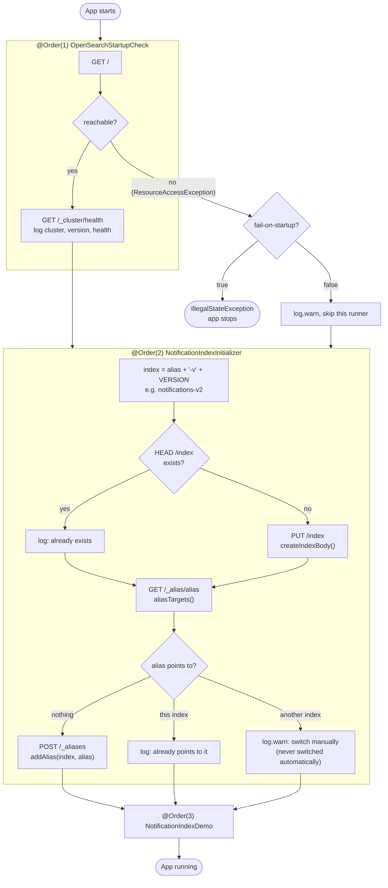
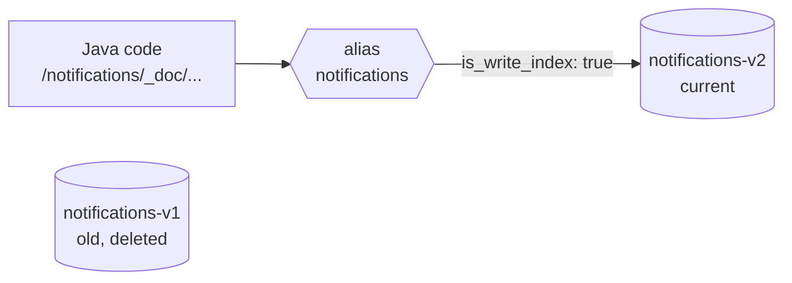
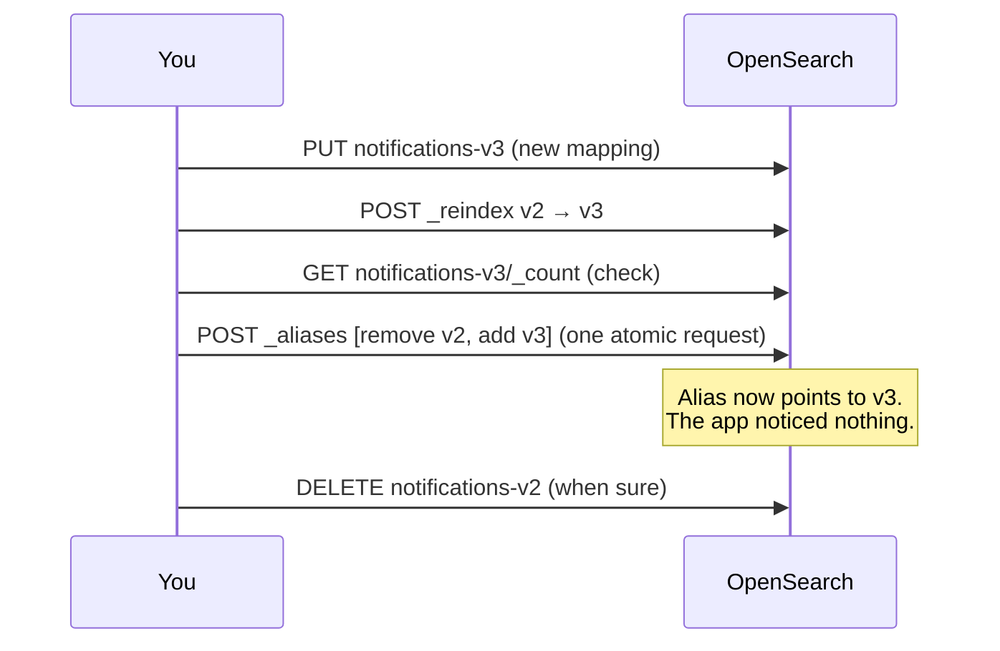
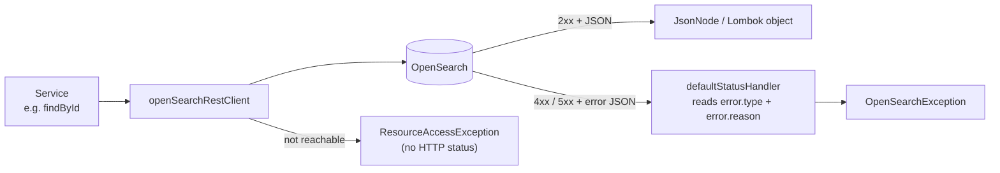

# notifyhub-search

The OpenSearch module of notifyhub. It knows how to talk to OpenSearch, how the
`notifications` index looks, and how to set it up when the app starts.

The module has **no main class** and **no `application.properties`**. It is a library:
`notifyhub-app` depends on it, starts it, and provides its configuration.

---

## 1. The big picture



Java and Dev Tools send **the same JSON** to OpenSearch. Every request is tried in
Dev Tools first (see `devtools/`), then written in Java.

---

## 2. Classes and what they do

| Package     | Class                                       | Responsibility                                                                              |
|-------------|---------------------------------------------|---------------------------------------------------------------------------------------------|
| `config`    | `OpenSearchProperties`                      | Reads `notifyhub.opensearch.*` from the app's `application.properties`                      |
| `config`    | `OpenSearchConfig`                          | Creates the `openSearchRestClient` bean: base URL, JSON header, error translation           |
| `exception` | `OpenSearchException`                       | One exception for every OpenSearch error: `status`, `type`, `reason`, `isNotFound()`        |
| *(root)*    | `OpenSearchStartupCheck`                    | Runner 1: is OpenSearch reachable? Logs cluster name, version, health                       |
| `mapping`   | `MappingBuilder`                            | Small fluent builder: `.keyword("id").textWithKeyword("subject")...` → mapping `ObjectNode` |
| `mapping`   | `NotificationIndexDefinition`               | **What** the index looks like: settings, mappings, `VERSION`                                |
| `mapping`   | `NotificationIndexInitializer`              | Runner 2: creates index and alias if they are missing                                       |
| `service`   | `IndexAdminService`                         | Generic index operations: `indexExists`, `createIndex`, `aliasTargets`, `addAlias`          |
| `service`   | `NotificationIndexService`                  | Document operations: `index`, `findById`, `updateStatus`, `deleteById`                      |
| `document`  | `NotificationDocument`                      | Lombok class = one document in the index (`_source`)                                        |
| `document`  | `NotificationChannel`, `NotificationStatus` | Enums stored as `keyword` values                                                            |
| `demo`      | `NotificationIndexDemo`                     | Runner 3: temporary playground, removed later                                               |



**Rule of thumb:** `IndexAdminService` works on **indices and aliases** and knows nothing
about notifications. `NotificationIndexService` works on **documents**.

---

## 3. What happens when the app starts

Spring runs the three `ApplicationRunner`s in `@Order` sequence, after the context has started.



The initializer is **idempotent**: running it twice gives the same result. The first start
creates what is missing; every later start only logs "already exists".

---

## 4. Aliases

The application **never** uses a real index name. It always talks to the alias
`notifications`, and the alias points to the current version of the index.



### Switching to a new version (done by hand in Phase 1, from Java in Phase 8)



Why this is needed: a field's **type can never change** in an existing index.
A new type means a new index, and the alias makes the switch invisible to the app.

| Situation at startup                       | What the initializer does                                |
|--------------------------------------------|----------------------------------------------------------|
| Index and alias missing (fresh OpenSearch) | Creates both                                             |
| Index exists, alias missing                | Adds the alias                                           |
| Both exist and match                       | Nothing, just logs                                       |
| `VERSION` raised, alias still on old index | Creates the new index, **warns**, leaves the alias alone |

---

## 5. A request and its errors



| What happened                              | Exception                                                      | Typical handling                      |
|--------------------------------------------|----------------------------------------------------------------|---------------------------------------|
| Document or index not found (404)          | `OpenSearchException`, `isNotFound()` = true                   | `Optional.empty()` / `false`          |
| Unknown field with `dynamic: strict` (400) | `OpenSearchException`, type `strict_dynamic_mapping_exception` | Rethrow, it's a bug                   |
| OpenSearch down                            | `ResourceAccessException`                                      | Startup: depends on `fail-on-startup` |

---

## 6. Configuration

In `notifyhub-app/src/main/resources/application.properties`:

| Property                               | Example                 | Meaning                                                                   |
|----------------------------------------|-------------------------|---------------------------------------------------------------------------|
| `notifyhub.opensearch.base-url`        | `http://localhost:9200` | Where OpenSearch runs                                                     |
| `notifyhub.opensearch.alias`           | `notifications`         | The alias the app uses; the index name is derived from it                 |
| `notifyhub.opensearch.fail-on-startup` | `false`                 | `true`: app stops if OpenSearch is down. `false`: app runs without search |

Never put an `application.properties` in this module: the app's file has the same name
and location on the classpath, so only one of them would be read.

---

## 7. Running it locally

```
docker compose up -d        # OpenSearch, Dashboards, Postgres
docker compose ps           # all three running?
mvn clean install           # builds all modules + runs the unit tests
```

Then start `NotifyhubAppApplication`. Dev Tools: <http://localhost:5601> → Dev Tools.

Useful Dev Tools checks:

```
GET _cat/indices/notifications*?v
GET _cat/aliases?v
GET notifications/_mapping
GET notifications/_count
```

---

## 8. Tests

| Test                              | Checks                                                   |
|-----------------------------------|----------------------------------------------------------|
| `NotificationIndexDefinitionTest` | Java mapping + settings equal the JSON used in Dev Tools |
| `MappingBuilderTest`              | `textWithKeyword` produces the right sub-field           |

Plain JUnit, no Spring, no OpenSearch needed. `assertEquals` on two `JsonNode`s compares
structure, not text, so field order and spacing don't matter.

---

## 9. `devtools/` folder

Every Dev Tools request, in the order it was run, per phase. The Java code must send
exactly this JSON, so this is the reference when something doesn't work.

See `../OpenSearchRoadmap.md` for the full learning plan.